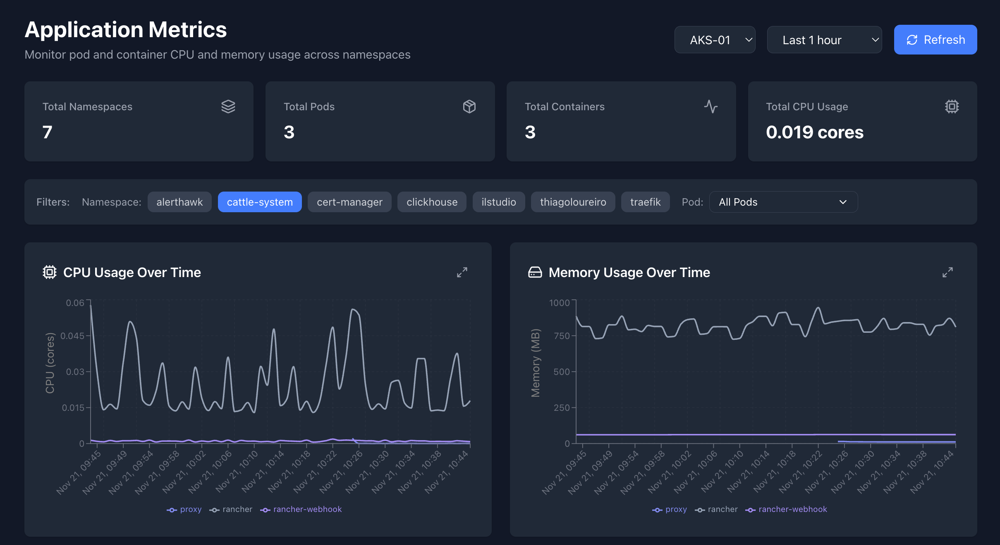
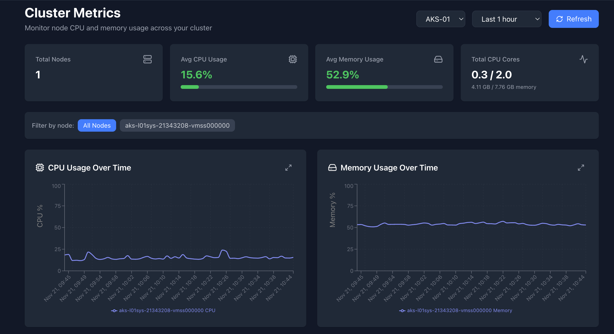

# AlertHawk UI

<p align="center">
  
</p>

<p align="center">
  <strong>Modern web UI for <a href="https://alerthawk.net">AlertHawk</a></strong> — self-hosted monitoring, metrics, alerts, and FinOps.
</p>

<p align="center">
  <a href="https://alerthawk.net"></a>
  <a href="https://docs.alerthawk.net/intro.html"></a>
  <a href="https://github.com/thiagoloureiro/AlertHawk"></a>
</p>

<p align="center">
  
  
  
  
  
  
  
  
  
</p>

---

## Overview

**AlertHawk UI** is the front-end for the [AlertHawk](https://github.com/thiagoloureiro/AlertHawk) monitoring platform. It talks to the Auth, Monitoring, Notification, Metrics, and FinOps APIs and gives you a single place to manage uptime monitors, Kubernetes metrics, alerts, SSL certificates, notifications, and Azure cost insights.

Live product: [https://alerthawk.net](https://alerthawk.net)

## Features

| Area | What you get |
| --- | --- |
| **Monitoring** | Dashboards, monitor details, groups, agents, and alert history |
| **Status pages** | Public `/status` views for uptime visibility |
| **Metrics** | Application, cluster, volume, and diagram views (when metrics are enabled) |
| **FinOps** | Azure subscription cost browsing, analysis jobs, forecasts, and AI recommendations |
| **SSL** | Certificate expiration monitoring |
| **Notifications** | Channel and notification management |
| **Admin** | User management and administration (admin-gated) |
| **Auth** | Local login plus Microsoft / Azure AD via MSAL |

## Screenshots

<p align="center">
  
</p>
<p align="center"><em>Application metrics</em></p>

<p align="center">
  
</p>
<p align="center"><em>Cluster metrics</em></p>

## Tech stack

- **React 19** + **TypeScript**
- **Vite 8** for local dev and production builds
- **Tailwind CSS 4** for styling
- **React Router 7** for routing
- **Axios** HTTP clients per backend service
- **@azure/msal-browser / msal-react** for Azure AD
- **Recharts** for cost and metrics charts
- **Sentry** (optional) for error reporting
- **nginx** multi-stage Docker image for production

## Prerequisites

- Node.js 20+ (Node 26 is used in the Docker build)
- npm
- Running AlertHawk backend services (Auth, Monitoring, Notification; Metrics and FinOps as needed)

## Getting started

```bash
git clone https://github.com/thiagoloureiro/AlertHawk.UI.V2.git
cd AlertHawk.UI.V2
npm install
cp .env.example .env   # or create .env from the variables below
npm run dev
```

App defaults to [http://localhost:5173](http://localhost:5173).

### Scripts

| Command | Description |
| --- | --- |
| `npm run dev` | Start Vite dev server |
| `npm run build` | Production build to `dist/` |
| `npm run preview` | Serve the production build on port 5173 |
| `npm run lint` | Run ESLint |

## Environment variables

Create a `.env` in the project root. All client-facing values use the `VITE_` prefix.

| Variable | Purpose |
| --- | --- |
| `VITE_APP_AUTH_API_URL` | Auth service base URL |
| `VITE_APP_MONITORING_API_URL` | Monitoring service base URL |
| `VITE_APP_NOTIFICATION_API_URL` | Notification service base URL |
| `VITE_APP_METRICS_API_URL` | Metrics API base URL |
| `VITE_APP_FINOPS_API_URL` | FinOps API base URL |
| `VITE_APP_CLIENT_ID` | Azure AD app (client) ID |
| `VITE_APP_TENANT_ID` | Azure AD tenant ID |
| `VITE_APP_AUTHORITY` | Azure AD authority URL |
| `VITE_APP_REDIRECT_URI` | OAuth redirect URI (e.g. `http://localhost:5173`) |
| `VITE_MSAL_SCOPES` | MSAL scopes (if used) |
| `VITE_APP_INSTANCE` | Instance / environment label |
| `VITE_APP_VERSION` | App version shown in Settings |
| `VITE_APP_DEV_TOOLS` | Enable extra dev tooling |
| `VITE_APP_METRICS_ENABLED` | Show metrics routes when `true` |
| `VITE_APP_QR_CODE` | Enable mobile QR dialog when `true` |
| `VITE_APP_SENTRY_DSN` | Optional Sentry DSN |
| `VITE_APP_ABBY_API_URL` | Optional AI (Abby) API base URL |
| `VITE_APP_ABBY_API_KEY` | Optional AI API key |
| `VITE_APP_ABBY_ENABLED` | Enable AI analysis when `true` |

> Trailing slashes on API URLs should match how your backends are exposed (the UI concatenates paths like `api/...`).

## Docker

Multi-stage build: Node compiles the app, then nginx serves `dist/` on port **8080**.

```bash
docker build -t alerthawk-ui .
docker run --rm -p 8080:8080 alerthawk-ui
```

Vite env vars are baked in at **build** time. Pass them as build args or ensure `.env` is available during `npm run build` inside the image (or bake a CI step that injects them before `docker build`).

For Kubernetes, use the [AlertHawk Helm chart](https://github.com/thiagoloureiro/AlertHawk.Chart), which deploys `alerthawk-ui` with the other services.

## Project structure

```
src/
  auth/          # MSAL configuration
  components/    # Shared UI, modals, layout, charts
  pages/         # Route-level screens
  routes/        # React Router definitions
  services/      # API clients (monitoring, auth, finops, …)
  lib/           # Helpers and feature flags
```

## Related repositories

| Repo | Role |
| --- | --- |
| [AlertHawk](https://github.com/thiagoloureiro/AlertHawk) | Backend microservices |
| [AlertHawk.Chart](https://github.com/thiagoloureiro/AlertHawk.Chart) | Helm charts |
| [docs.alerthawk.net](https://docs.alerthawk.net/intro.html) | Product documentation |

## Contributing

1. Fork and create a feature branch
2. Keep fetching/API contracts intact unless intentionally changing backend contracts
3. Run `npm run lint` and `npm run build` before opening a PR

## License

AlertHawk is released under the [MIT License](https://github.com/thiagoloureiro/AlertHawk/blob/main/LICENSE). This UI follows the same project licensing.
